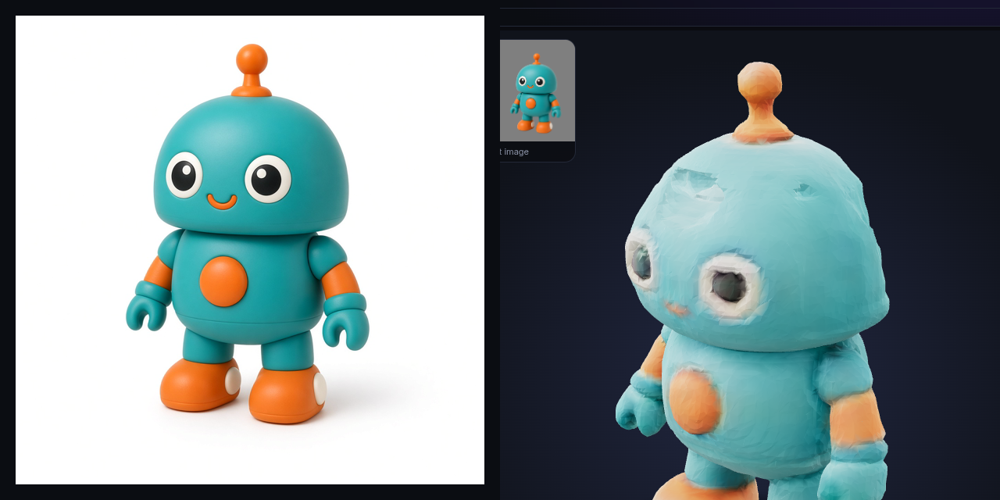
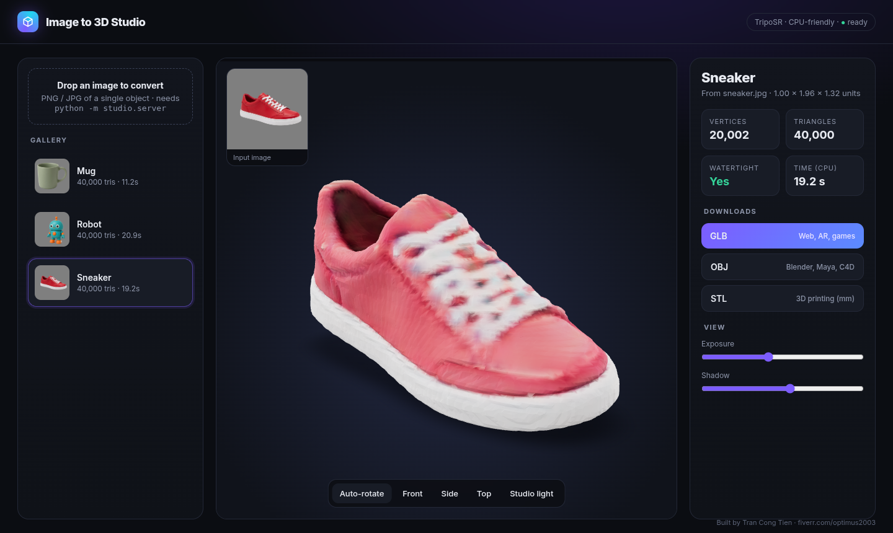

# Image to 3D Studio

**Turn one product photo into a clean, web- and print-ready 3D model in ~15 seconds on a plain CPU.**
Background removal → [TripoSR](https://github.com/VAST-AI-Research/TripoSR) reconstruction → mesh cleanup &
decimation → GLB / OBJ / STL export → a polished web viewer with AR, stats and downloads.

<p align="center"></p>

| Input photo → generated GLB | Web viewer |
| --- | --- |
|  |  |

All three sample models in [`examples/models`](examples/models) were produced by this repo on an 8-core CPU box with **no GPU**
(robot ≈ 21 s, sneaker ≈ 19 s, mug ≈ 11 s including background removal and export).

## Features

- **Single image → 3D** with TripoSR (MIT), runs on CPU or CUDA automatically.
- **No compiler toolchain needed** – the vendored TripoSR uses scikit-image marching cubes instead of the `torchmcubes` C++/CUDA extension, so `pip install` works anywhere.
- **Automatic cut-out** – rembg (`isnet-general-use`) removes the background when the image has no alpha channel.
- **Mesh cleanup** – drops floating fragments, degenerate faces and duplicate vertices, fixes normals, keeps vertex colours.
- **Optimized output** – quadric decimation to a target triangle count (default 40k), Y-up orientation facing +Z, centered and resting on the ground.
- **Every format a client asks for** – `GLB` (web/AR/games), `OBJ` (Blender, Maya, C4D), `STL` scaled to real millimetres for 3D printing, plus a JSON report (vertices, faces, watertight, size, time).
- **Web viewer** – `<model-viewer>` with orbit controls, auto-rotate, preset views, exposure/shadow controls, WebXR / Scene Viewer / Quick Look AR, side-by-side input image and download buttons.
- **Local web app** – drag-and-drop an image, get a model back (`python -m studio.server`).

## Quick start

```bash
python -m venv .venv && source .venv/bin/activate
pip install torch --index-url https://download.pytorch.org/whl/cpu   # or the CUDA wheel
pip install -r requirements.txt

# CLI – one or many images (weights ~1.7 GB download from Hugging Face on first run)
python -m studio convert examples/inputs/robot.jpg -o outputs/
python -m studio convert photos/*.png --faces 20000 --formats glb,stl --stl-height-mm 120

# Web app with upload → http://127.0.0.1:8000
python -m studio.server

# Static gallery only (no Python model needed)
python -m http.server 8765   # open http://127.0.0.1:8765/viewer/
```

`--resolution 320` gives finer geometry (slower), `--faces 0` keeps the full mesh, `--device cuda` forces GPU.

## Tips for good results

One object, centred, whole object in frame, plain background, soft light, three-quarter view. Shiny or transparent objects
and thin structures (cables, hair) are the hardest cases for any single-view model. For production assets I finish the
mesh in Blender (retopology, UV unwrap, texture bake, booleans for printing).

## Project layout

```
studio/pipeline.py    rembg + TripoSR + post-processing (ImageTo3D class)
studio/mesh_tools.py  orientation, cleanup, decimation, export, stats (pure trimesh, unit-tested)
studio/server.py      FastAPI upload API + static viewer
studio/cli.py         `python -m studio convert|gallery`
viewer/               model-viewer web UI (vendored model-viewer, BSD-3-Clause)
third_party/tsr/      TripoSR model code (MIT), marching cubes patched to scikit-image
tools/capture.py      Playwright + FFmpeg script that renders the README screenshots and turntables
```

## Tests

```bash
pip install -r requirements-dev.txt && pytest -q
```

## Credits & licenses

- [TripoSR](https://github.com/VAST-AI-Research/TripoSR) by Tripo AI & Stability AI – MIT (code and weights). Vendored in `third_party/tsr` with its license.
- [rembg](https://github.com/danielgatis/rembg) – MIT. [trimesh](https://github.com/mikedh/trimesh) – MIT. [scikit-image](https://scikit-image.org/) – BSD-3.
- [`<model-viewer>`](https://github.com/google/model-viewer) by Google – BSD-3-Clause (vendored in `viewer/vendor`).
- Sample input photos are AI-generated for this demo.

This repository's own code is MIT © Tran Cong Tien.

---

**Need a 3D model from your product photo, an STL for printing, or an interactive 3D viewer for your store?**
Hire me on Fiverr: [fiverr.com/optimus2003](https://www.fiverr.com/optimus2003)
