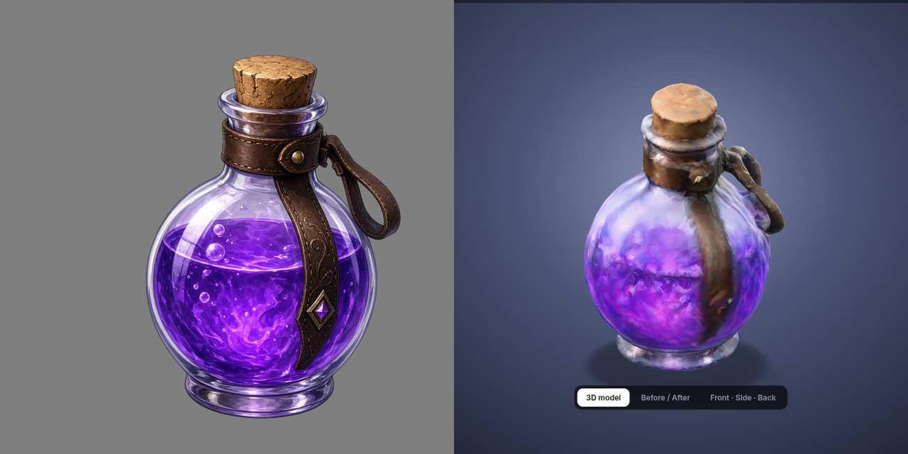
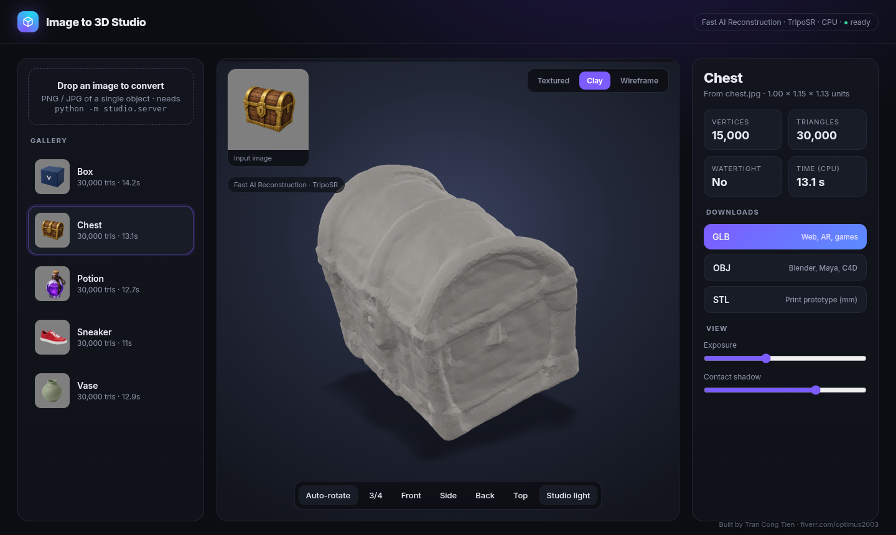
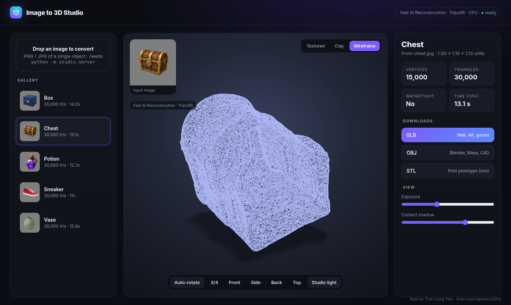
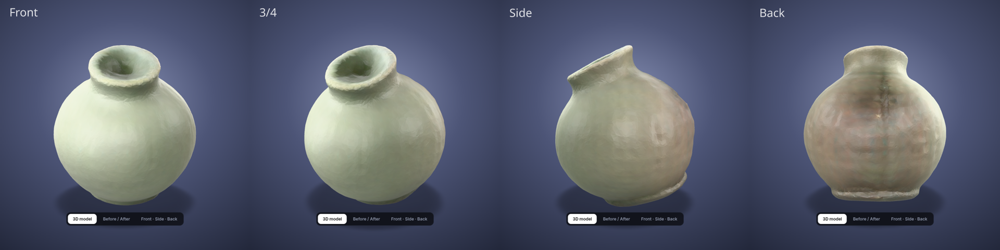

# Image to 3D Studio

**Turn one product photo into a textured 3D model in about 15 seconds — on a plain CPU.**
Background removal → [TripoSR](https://github.com/VAST-AI-Research/TripoSR) reconstruction → smoothing & decimation →
GLB / OBJ / STL → a studio-lit web viewer with textured, clay and wireframe modes.

<p align="center"></p>

## Demo

[](docs/demo-video.mp4)

**Demo video** (1920×1080, ~50 s, English voice-over and captions): [`docs/demo-video.mp4`](docs/demo-video.mp4)

| Input photo → generated model (game prop) | Input photo → generated model (game prop) |
| --- | --- |
|  |  |

**Web viewer** — studio lighting, contact shadow, gradient stage, 3/4 camera, textured / clay / wireframe toggle:

| Textured | Clay | Wireframe |
| --- | --- | --- |
|  |  |  |

**Multi-angle views** (front · 3/4 · side · back):




More: [box angles](docs/angles-box.png) · [potion angles](docs/angles-potion.png) · [sneaker angles](docs/angles-sneaker.png) ·
[vase viewer](docs/viewer-vase.png) · [sneaker viewer](docs/viewer-sneaker.png) · [upload in progress](docs/upload-processing.png) ·
[upload result](docs/upload-result.png) · [turntable MP4](docs/turntable.mp4)

## The business problem

Online stores, indie game studios and makers want 3D versions of products and props — for 360° product pages, AR
previews, quick game blockouts or a first print prototype — but manual modelling costs hours per object. This project
gets a usable first model from a single photo in seconds, and gives a clear path to a polished asset when it matters.

## Two service levels (honest scope)

| | **Fast AI Reconstruction** (this repo, automatic) | **Refined Asset** (manual finishing in Blender) |
| --- | --- | --- |
| Time | ~15 s per image on CPU | hours, depending on the object |
| Geometry | Single-view guess; hidden sides are inferred, fine details softened | Corrected proportions, clean topology / retopology |
| Texture | Vertex colours from the photo | UV unwrap + baked / hand-painted textures, PBR materials |
| Good for | Previews, 360° spins, AR mockups, game blockouts, concept review | Store hero assets, game-ready props, printable parts |
| Printing | STL export for a **prototype** — check walls and watertightness first | Repaired, hollowed / solidified, slicer-checked |

## Features

- **Single image → 3D** with TripoSR (MIT), CPU or CUDA automatically
- **No compiler toolchain** — vendored TripoSR uses scikit-image marching cubes instead of the `torchmcubes` extension
- **Automatic cut-out** — rembg (`isnet-general-use`) when the image has no alpha channel
- **Mesh cleanup** — removes floating fragments, degenerate faces and duplicate vertices; Taubin smoothing (no shrinking); quadric decimation to a target triangle count (default 30k) with vertex colours re-sampled
- **Correct colours** — vertex colours converted from sRGB to linear for glTF, so models don't look washed out
- **Exports** — `GLB` (web/AR/games), `OBJ` (Blender, Maya, C4D), `STL` scaled to millimetres, JSON report (vertices, faces, watertight, size, time)
- **Web viewer** — `<model-viewer>` with studio environment light, contact shadow, gradient background, 3/4 default camera, preset angles (3/4, front, side, back, top), textured / clay / wireframe modes, exposure & shadow sliders, AR (WebXR / Scene Viewer / Quick Look), downloads
- **Local web app** — drag-and-drop an image, get a model back (`python -m studio.server`)
- **Media script** — Playwright + FFmpeg renders screenshots, multi-angle sheets, before/after images and the 360° turntable

## Results

All five sample models in [`examples/models`](examples/models) were generated by this repo on an 8-core CPU box with **no GPU**
(`--resolution 288`, 30k triangles, including background removal and export):

| Model | Type | Time | Watertight |
| --- | --- | --- | --- |
| Vase | home decor | 12.9 s | yes |
| Box | packaging | 14.2 s | yes |
| Chest | game prop | 13.1 s | no |
| Potion | game prop | 12.7 s | no |
| Sneaker | product | 11.0 s | yes |

Known weak spots are visible on purpose: the back of the vase is inferred, and the box faces are slightly bevelled.

## Architecture

```
photo ──► rembg cut-out ──► TripoSR (triplane NeRF) ──► marching cubes ──► cleanup ─► Taubin smooth ─► decimate
                                                                                                   │
                       viewer (model-viewer) ◄── GLB / OBJ / STL + JSON report ◄──────────────────┘

studio/pipeline.py    rembg + TripoSR + post-processing (ImageTo3D class)
studio/mesh_tools.py  orientation, cleanup, smoothing, decimation, colour space, export, stats (unit-tested)
studio/server.py      FastAPI upload API + static viewer
studio/cli.py         `python -m studio convert|gallery`
viewer/               web UI (vendored model-viewer, BSD-3-Clause)
third_party/tsr/      TripoSR model code (MIT), marching cubes patched to scikit-image
tools/capture.py      renders README media (screenshots, angles, before/after, turntable)
```

## Quick start & tests

```bash
python -m venv .venv && source .venv/bin/activate
pip install torch --index-url https://download.pytorch.org/whl/cpu   # or the CUDA wheel
pip install -r requirements.txt

# CLI (TripoSR weights ~1.7 GB download from Hugging Face on first run)
python -m studio convert examples/inputs/chest.jpg -o outputs/
python -m studio convert photos/*.png --faces 20000 --smooth 8 --formats glb,stl --stl-height-mm 120

# Web app with upload -> http://127.0.0.1:8000
python -m studio.server

# Static gallery only (no model needed)
python -m http.server 8765   # open http://127.0.0.1:8765/viewer/

# Tests
pip install -r requirements-dev.txt && pytest -q
```

`--resolution 320` gives finer geometry (slower), `--faces 0` keeps the full mesh, `--smooth 0` disables smoothing,
`--device cuda` forces GPU. Best input: one object, centred, whole object in frame, plain background, soft light, matte surface.

## Limitations & roadmap

- Single-view reconstruction: hidden sides are guessed; glossy, transparent and thin parts (cables, straps) are hard
- Vertex colours, not UV textures — fine for viewing, not for texture editing
- STL output is a starting point for prototypes, not a guaranteed print-ready part
- Roadmap: multi-view input (front + back photos), UV unwrap + texture bake, automatic hole filling / solidify for printing, GPU batch mode, Shopify / WooCommerce 3D embed snippet

## Credits & license

- [TripoSR](https://github.com/VAST-AI-Research/TripoSR) by Tripo AI & Stability AI — MIT (code and weights), vendored in `third_party/tsr`
- [rembg](https://github.com/danielgatis/rembg) — MIT · [trimesh](https://github.com/mikedh/trimesh) — MIT · [fast-simplification](https://github.com/pyvista/fast-simplification) — MIT · [scikit-image](https://scikit-image.org/) — BSD-3
- [`<model-viewer>`](https://github.com/google/model-viewer) by Google — BSD-3-Clause (vendored in `viewer/vendor`)
- Sample input photos are AI-generated for this demo

This repository's own code is MIT © Tran Cong Tien.

---

**Need a 3D model from your product photo, a 360° viewer for your store, or game props from concept art?**
Hire me on Fiverr: [fiverr.com/optimus2003](https://www.fiverr.com/optimus2003)
