# Image to 3D Studio

**Turn one product photo into a textured 3D model on a plain CPU (11–15 s per sample image on an 8-core box, longer on a busy machine).**

> **What this is (and isn't):** AI reconstruction from a single photo, with optional manual cleanup in Blender. It is *not* precision CAD or photogrammetry — dimensions come from the height you type, and hidden sides are guessed by the model.
Background removal → [TripoSR](https://github.com/VAST-AI-Research/TripoSR) reconstruction → smoothing & decimation →
GLB / OBJ / STL → a studio-lit web viewer with textured, clay and wireframe modes.

<p align="center">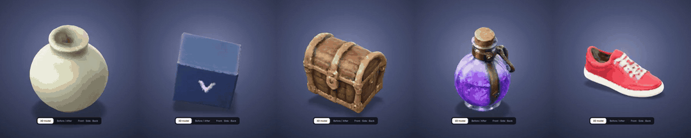</p>

## Demo

[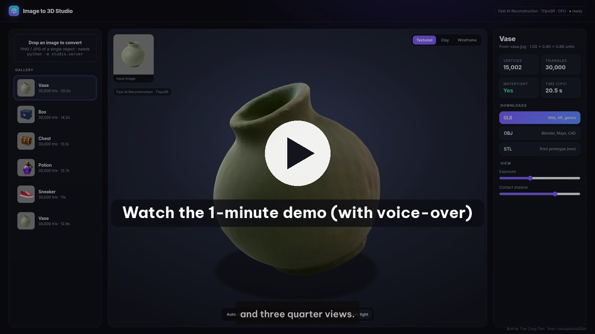](docs/demo-video.mp4)

**Demo video** (1920×1080, ~60 s, English voice-over and large captions, −15 LUFS): opens on the before/after slider, then a live CPU upload (the slow reconstruction wait is cut), front/side/back check, STL at a typed real height, 360° turntable, share page with AR QR, and the downloaded GLB in a separate web viewer and as a Blender Cycles render: [`docs/demo-video.mp4`](docs/demo-video.mp4). The video shows the QR/share page only — the phone AR session itself needs the page hosted on HTTPS and is not filmed.

**Before / after slider** — the input photo and the live 3D model in the same frame, drag the handle to compare:

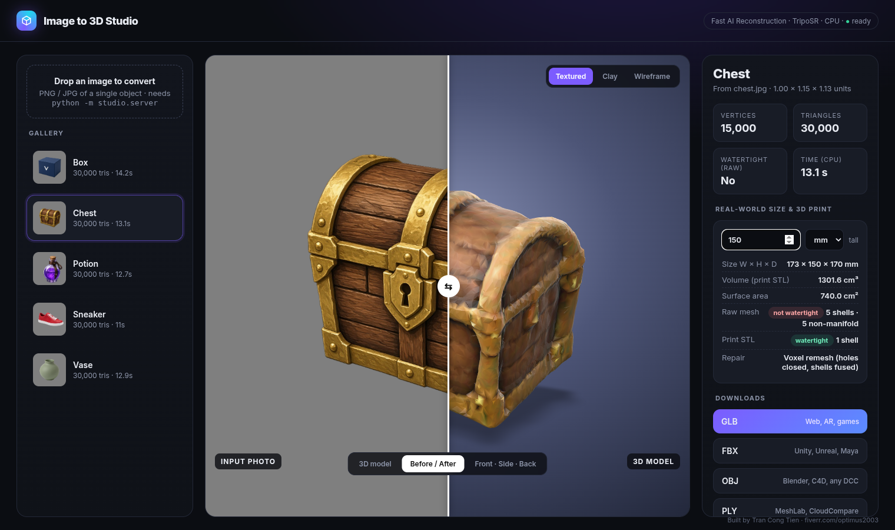

**Real-world size & 3D-print check** — type the real height (mm / cm / in), get W × H × D, volume and surface area,
raw-mesh problems (open edges, non-manifold edges, loose shells) and a repaired, watertight print STL:

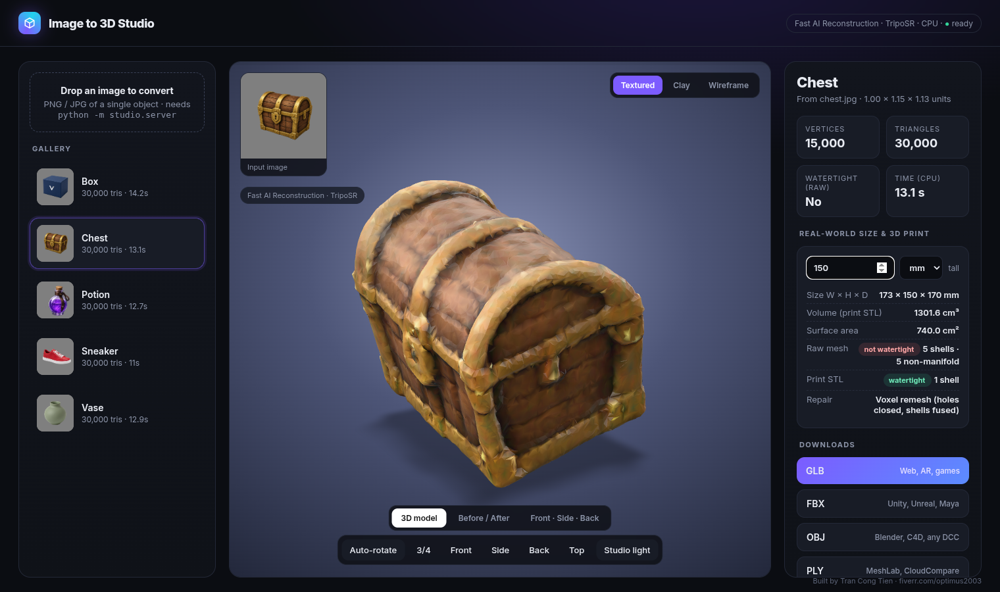

| Front · side · back renders (+ optional reference photos per view) | Share link · QR code to AR · embed snippet |
| --- | --- |
| 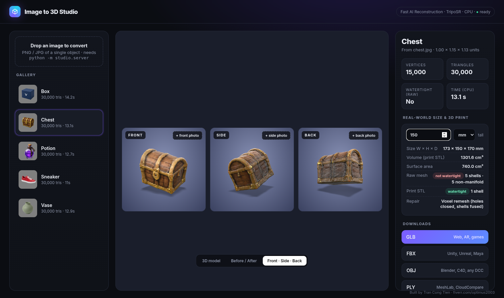 | 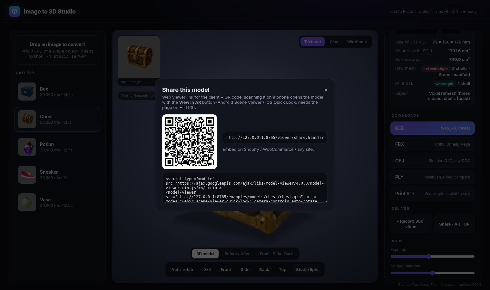 |

| Client share page (QR → phone → "View in your room" AR) | Same GLB opened and rendered in Blender 4.2 (Cycles, CPU) |
| --- | --- |
| 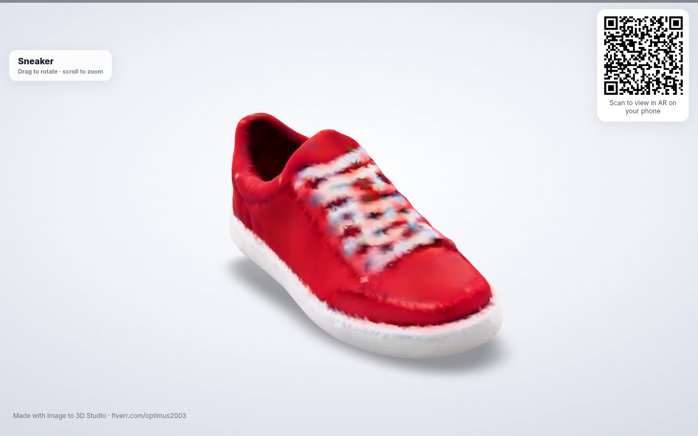 | 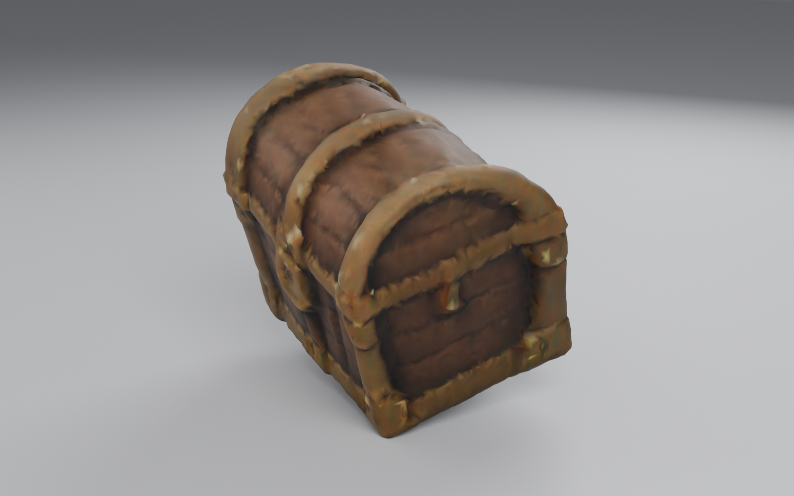 |

**360° turntables** for every model — MP4 + GIF in [`docs/turntables/`](docs/turntables/) (also recordable as WebM from the viewer):

<p align="center">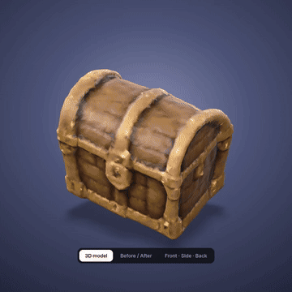 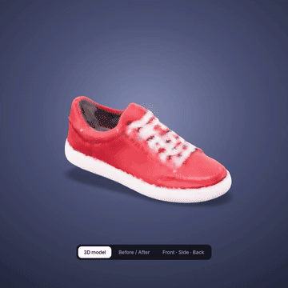 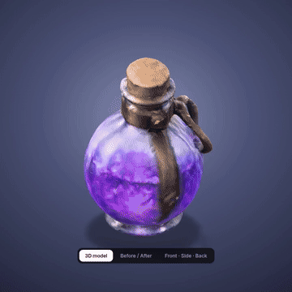</p>

| Input photo → generated model (game prop) | Input photo → generated model (game prop) |
| --- | --- |
| 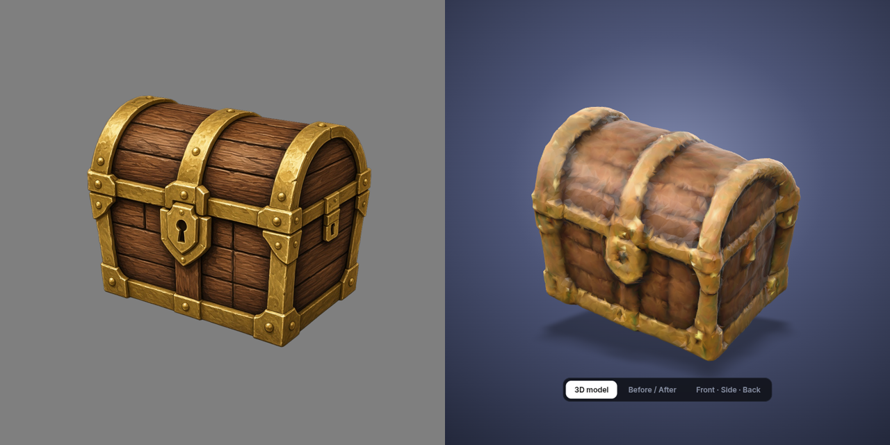 |  |

| Textured | Clay | Wireframe |
| --- | --- | --- |
| 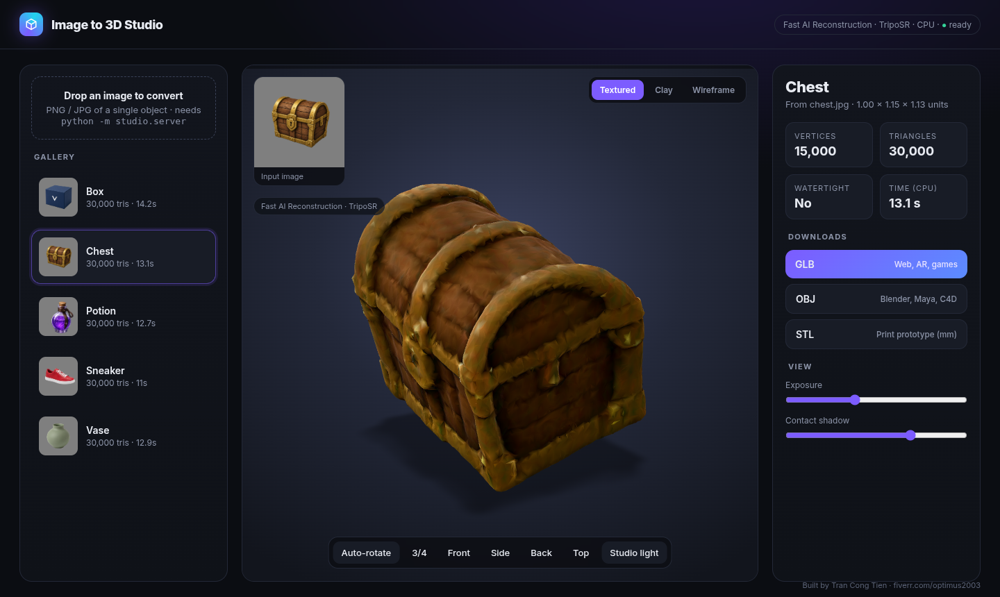 |  |  |

**Multi-angle sheets** (front · 3/4 · side · back):

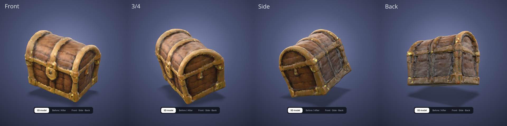

More: [box](docs/angles-box.png) · [potion](docs/angles-potion.png) · [sneaker](docs/angles-sneaker.png) · [vase](docs/angles-vase.png) ·
[upload in progress](docs/upload-processing.png) · [upload result](docs/upload-result.png) · [5-model turntable MP4](docs/turntable.mp4)

## What a client receives (deliverables)

| Deliverable | File / where | Notes |
| --- | --- | --- |
| Web / AR model | `name.glb` | glTF binary, vertex colours in linear space, ~0.6 MB at 30k triangles |
| Game engine / DCC model | `name.fbx` | Binary FBX via Blender (vertex colours wired to a material), Y-up. All 5 sample FBX files were re-imported in Blender 4.2.3 headless: 1 mesh each, 29,991–30,000 faces, colour attribute + material present |
| Editable mesh | `name.obj`, `name.ply` | OBJ for Blender / C4D, coloured PLY for MeshLab / CloudCompare |
| 3D-print file | `name_print.stl` | Repaired mesh, scaled to the real height you choose (default 120 mm). The viewer only labels it watertight when the measured post-repair check passes (it does for all 5 samples); otherwise it is flagged "needs manual cleanup" |
| Mesh & print report | `name_print.json` + viewer panel | Triangles, open / non-manifold edges, shells, watertight before → after, W × H × D (mm), volume (cm³), area |
| Preview renders | front · side · back PNGs, before/after image | From the viewer or `tools/capture.py` |
| 360° turntable | `turntables/name.mp4` + `.gif` | 72 frames, 24 fps; WebM recording also available in the browser |
| Share page + AR QR | `viewer/share.html?src=…` | `<model-viewer>` with AR (Scene Viewer / Quick Look) – needs HTTPS hosting for phones |
| Store embed snippet | copy from the Share dialog | Paste-ready `<model-viewer>` tag for Shopify / WooCommerce / any site |

## The business problem

Online stores, indie game studios and makers want 3D versions of products and props — for 360° product pages, AR
previews, quick game blockouts or a first print prototype — but manual modelling costs hours per object. This project
gets a usable first model from a single photo in well under a minute on a normal CPU, and gives a clear path to a polished asset when it matters.

## Two service levels (honest scope)

| | **Fast AI Reconstruction** (this repo, automatic) | **Refined Asset** (manual finishing in Blender) |
| --- | --- | --- |
| Time | ~11–15 s per sample image on an 8-core CPU | hours, depending on the object |
| Geometry | Single-view guess; hidden sides are inferred, fine details softened | Corrected proportions, clean topology / retopology |
| Texture | Vertex colours from the photo | UV unwrap + baked / hand-painted textures, PBR materials |
| Good for | Previews, 360° spins, AR mockups, game blockouts, concept review | Store hero assets, game-ready props, printable parts |
| Printing | STL export for a **prototype** — check walls and watertightness first | Repaired, hollowed / solidified, slicer-checked |

## Features

- **Single image → 3D** with TripoSR (MIT), CPU or CUDA automatically
- **No compiler toolchain** — vendored TripoSR uses scikit-image marching cubes instead of the `torchmcubes` extension
- **Automatic cut-out** — rembg (`isnet-general-use`) when the image has no alpha channel
- **Mesh cleanup** — removes floating fragments, degenerate faces and duplicate vertices; Taubin smoothing (no shrinking); quadric decimation to a target triangle count (default 30k) with vertex colours re-sampled
- **Correct colours** — vertex colours converted from sRGB to linear for glTF, so models don't look washed out
- **Multi-format export** — GLB, OBJ, PLY, STL, plus **FBX** when Blender is installed (`python -m studio deliver … --fbx`)
- **3D-print repair** — hole fill + normal fix, falling back to a voxel remesh (flood-filled, marching cubes, Taubin smoothed) that closes holes, fuses overlapping shells and removes non-manifold edges; only keeps a decimated version if it is still a closed manifold
- **Real-world scale** — enter the target height in mm / cm / inches: dimensions, volume and area update live, and the print STL downloads scaled to that exact size (scaled in the browser)
- **Before / after slider**, **front · side · back** renders with optional per-view reference photos for side-by-side QA
- **360° turntable** — MP4 + GIF per model (`tools/capture.py`) or a 6-second WebM straight from the viewer
- **Share page + QR to AR** — `share.html` with `<model-viewer ar>`, QR code (vendored `qrcode-generator`, MIT) and an embed snippet
- **Blender check render** — `tools/blender_render.py` opens the delivered GLB in Blender and renders a Cycles product shot
- **Web viewer** — studio environment light (brighter default exposure 1.3), contact shadow, preset angles, textured / clay / wireframe, exposure & shadow sliders, AR, downloads
- **Local web app** — drag-and-drop an image, get a model back (`python -m studio.server`)

### Multi-image input (front / side / back) — not implemented, on purpose

TripoSR reconstructs from **one** image. Real multi-view fusion needs a multi-view model (e.g. InstantMesh / Zero123++ style
pipelines) that wants a GPU with ~12–24 GB VRAM and minutes per object, so it is not part of this CPU-first repo. What the
viewer *does* support is loading your side / back photos next to the matching renders for a visual check, so hidden-side
guesses are obvious before delivery. On paid work, a wrong back side is fixed by hand in Blender (the "Refined Asset" tier).

## Results

All five sample models in [`examples/models`](examples/models) were generated by this repo on an 8-core CPU box with **no GPU**
(`--resolution 288`, decimated to a 30k-triangle target, including background removal and export). Numbers below are
measured from the files (`name.json`, `name_print.json`), print size at a 120 mm height:

| Model | Type | Time (CPU) | Vertices | Raw mesh | Print STL after repair | Size W × H × D (mm) | Volume |
| --- | --- | --- | --- | --- | --- | --- | --- |
| Vase | home decor | 12.9 s | 15,003 | watertight, 2 shells | watertight, 1 shell (voxel remesh) | 108.7 × 120 × 106.9 | 625.3 cm³ |
| Box | packaging | 14.2 s | 15,002 | watertight, 1 shell | watertight, 1 shell (hole fill) | 133.1 × 120 × 138.0 | 677.4 cm³ |
| Chest | game prop | 13.1 s | 15,000 | **not** watertight: 5 shells, 5 non-manifold edges | watertight, 1 shell (voxel remesh) | 138.1 × 120 × 135.9 | 666.4 cm³ |
| Potion | game prop | 12.7 s | 14,979 | **not** watertight: 13 shells, 18 non-manifold edges | watertight, 1 shell (voxel remesh) | 82.7 × 120 × 82.9 | 313.9 cm³ |
| Sneaker | product | 11.0 s | 15,002 | watertight, 1 shell | watertight, 1 shell (hole fill) | 236.3 × 120 × 159.1 | 1,127.8 cm³ |

Known weak spots are visible on purpose: the back of the vase is inferred, the box faces are slightly bevelled, and the
chest's metal bands are softer than in the photo.

## Architecture

```
photo ──► rembg cut-out ──► TripoSR (triplane NeRF) ──► marching cubes ──► cleanup ─► Taubin smooth ─► decimate
                                                                                                   │
                       viewer (model-viewer) ◄── GLB / OBJ / STL + JSON report ◄──────────────────┘

studio/pipeline.py    rembg + TripoSR + post-processing (ImageTo3D class)
studio/mesh_tools.py  orientation, cleanup, smoothing, decimation, colour space, export, stats (unit-tested)
studio/deliver.py     delivery pack: print repair, real-world size report, PLY, optional FBX (Blender)
studio/server.py      FastAPI upload API + static viewer
studio/cli.py         `python -m studio convert|gallery`
viewer/               web UI (vendored model-viewer, BSD-3-Clause)
third_party/tsr/      TripoSR model code (MIT), marching cubes patched to scikit-image
tools/capture.py      renders README media (screenshots, angles, before/after, per-model turntables)
tools/capture_features.py  screenshots of the slider, 3 views, print panel, share dialog and share page
tools/blender_*.py    headless Blender helpers: GLB -> FBX, GLB check render
viewer/share.html     client share page with AR button + QR code
```

## Quick start & tests

```bash
python -m venv .venv && source .venv/bin/activate
pip install torch --index-url https://download.pytorch.org/whl/cpu   # or the CUDA wheel
pip install -r requirements.txt

# CLI (TripoSR weights ~1.7 GB download from Hugging Face on first run)
python -m studio convert examples/inputs/chest.jpg -o outputs/
python -m studio convert photos/*.png --faces 20000 --smooth 8 --formats glb,stl --stl-height-mm 120

# Delivery pack for existing model folders: print STL (watertight, real size), PLY, report, optional FBX
python -m studio deliver examples/models/* --height-mm 120 --fbx     # FBX needs Blender (PATH or $BLENDER)

# Web app with upload -> http://127.0.0.1:8000
python -m studio.server

# Static gallery only (no model needed)
python -m http.server 8765   # open http://127.0.0.1:8765/viewer/

# Tests
pip install -r requirements-dev.txt && pytest -q
```

`--resolution 320` gives finer geometry (slower), `--faces 0` keeps the full mesh, `--smooth 0` disables smoothing,
`--device cuda` forces GPU. Best input: one object, centred, whole object in frame, plain background, soft light, matte surface.

## Limitations & roadmap

- Single-view reconstruction: hidden sides are guessed; glossy, transparent and thin parts (cables, straps) are hard
- Vertex colours, not UV textures — fine for viewing, not for texture editing
- One photo in: proportions along the camera axis (depth) and the unseen back are estimated, not measured — expect a client review / cleanup round for anything that must match a real object
- Real-world size is a uniform scale from the one height you type; it is not a measurement of the object
- STL output is a starting point for prototypes, not a guaranteed print-ready part: "watertight" is a topology check, it does not check wall thickness, overhangs or tolerances (run it through your slicer)
- The voxel-remesh print repair softens detail below one voxel (~0.9 mm on a 120 mm part at the default 128 voxels; raise `--voxels`)
- AR on phones needs the share page served over HTTPS (any static host); on `127.0.0.1` the QR only works on the same machine
- FBX export depends on a local Blender install (tested with Blender 4.2 LTS)
- Roadmap: multi-view input on GPU, UV unwrap + texture bake, GPU batch mode

## Credits & license

- [TripoSR](https://github.com/VAST-AI-Research/TripoSR) by Tripo AI & Stability AI — MIT (code and weights), vendored in `third_party/tsr`
- [rembg](https://github.com/danielgatis/rembg) — MIT · [trimesh](https://github.com/mikedh/trimesh) — MIT · [fast-simplification](https://github.com/pyvista/fast-simplification) — MIT · [scikit-image](https://scikit-image.org/) — BSD-3
- [`<model-viewer>`](https://github.com/google/model-viewer) by Google — BSD-3-Clause (vendored in `viewer/vendor`)
- Sample input photos are AI-generated for this demo

This repository's own code is MIT © Tran Cong Tien.

---

**Need a 3D model from your product photo, a 360° viewer for your store, or game props from concept art?**
Hire me on Fiverr: [fiverr.com/optimus2003](https://www.fiverr.com/optimus2003)
