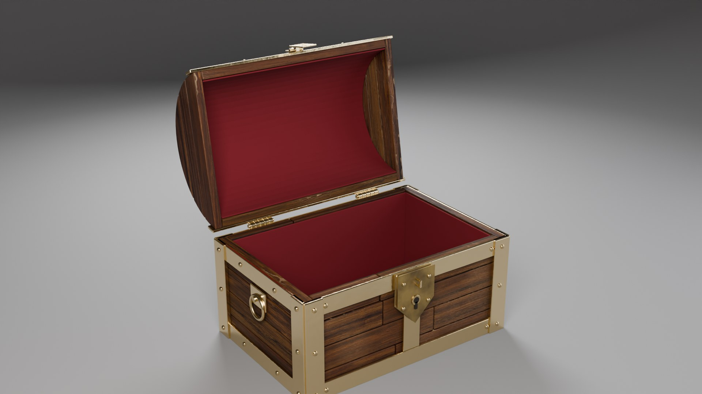

# Blender production pipeline (hand-built quality, scripted)

The AI path (`studio/`) turns one photo into a mesh in minutes, but the back of the object is guessed and
the surface is soft. For paid orders that need clean topology, real dimensions and a printable file, the
same reference image is rebuilt **parts-based in Blender with Python** (`bpy`, headless) and rendered with
Cycles.

Pilot: the treasure chest from `examples/models/chest/chest_input.png`.

| | |
|---|---|
| Size | 60 x 40 cm body, 63.1 x 45.4 x 44.1 cm overall (W x D x H) incl. handles, lock and hinges |
| Parts | 4 plank rows per face (staggered joints front / back), bottom board, 5 curved lid staves, 3-board lid ends, 3 lid straps, rim + base bands, L-shaped corner straps, 64 rivets, shield lock plate with keyhole, hasp, 2 strap hinges, 2 ring handles |
| Materials | PBR wood (Poly Haven CC0 texture, colour graded and baked into the files), hammered brass, all UV-mapped (grain follows each board) |
| Exports | `chest.glb`, `chest.fbx`, `chest.obj` (+mtl, textures), `chest_print_mm.stl` (single watertight shell, millimetres, Z up), `chest.blend` |
| Renders | front, 3/4, side, back (1920x1080, 64 spp + OpenImageDenoise), clay, wireframe, 360° turntable MP4 |

`output/chest/mesh_report.json` (trimesh) shows dimensions, triangle counts, watertight / manifold status.

```bash
blender -b -P blender_pipeline/build_chest.py -- --out blender_pipeline/output/chest --renders renders/ --samples 64 --turntable
.venv/bin/python blender_pipeline/validate_mesh.py blender_pipeline/output/chest
ffmpeg -framerate 24 -i blender_pipeline/output/chest/tt_frames/f_%04d.png -c:v libx264 -pix_fmt yuv420p -crf 18 turntable.mp4
```

Assets: `blender_pipeline/assets` -> Poly Haven downloads (CC0), see [CREDITS.md](CREDITS.md).

Headless `bpy` scripts are what a render server needs. For interactive sessions the same calls can be made
from an AI client through [MCP for Blender](https://github.com/ahujasid/mcp-for-blender) (Blender GUI addon +
`uvx mcp-for-blender`); it is optional here.

## Round 3: hardware, open lid, print proof



| | |
|---|---|
| Hinges | 2 rear hinges, 5 alternating knuckles each (Ø17 mm, 1.2 mm gaps) on a pin with domed caps. The body leaf is riveted to the back rim band, and the lid leaf sits on the lid edge band and runs straight into the lid knuckles, so there is no floating gap. The lid objects pivot on the hinge axis (`model_stats.json` → `hinge_axis_m`), so the lid can be opened in any DCC or engine |
| Latch | Shield lock plate with escutcheon and keyhole, a staple (2 posts and a bar) and a hasp hanging from a knuckle on the lid edge, slotted over the staple |
| Open-lid version | Velvet lining in the body and lid, optional gold coins (render only) |
| Materials | Per-plank tone and roughness variation, fine scratches. Aged brass: tarnish patches, dark grime in cavities (AO), polished convex edges (pointiness) |
| Exports | `chest.glb` / `.fbx` / `.obj`: 6 named objects (Body/Lid × Wood/Metal/Lining), 38,536 tris, re-imported and verified (`export_verification.json`: tri count and bbox 0.638 × 0.4595 × 0.4415 m match the source in all three formats). The `.blend` has packed textures |
| Print STL | `chest_print_mm.stl`: closed and solid, mm, Z up. After the pymeshlab self-intersection repair it is watertight, a single body, with 0 non-manifold edges/vertices, 0 boundary edges and 0 self-intersecting faces (`print_proof.json`). The minimum ray-cast thickness is 3.8 mm at 1:1. Feature sizes are listed per scale: at 1:1 every feature clears FDM 0.4 mm. At 25% (16 × 11.5 × 11 cm) the knuckle gap, plank gaps and lid seam fall below 0.8 mm, so use a 0.25 mm nozzle or resin. At 1:1 (64 cm) the model must be split for any common printer bed |
| Slicer | PrusaSlicer 2.8.1 CLI, headless, 25% scale: 706 layers, ~387 g PLA, ~1 d 1 h 45 min at 0.2 mm, 15% infill, with supports. The toolpath preview is drawn from the exported G-code (`renders/round3/slice_preview.jpg`). This shows a successful slice only; it has **not** been physically print-tested |

Renders (Cycles, 64 spp + OIDN, CPU): 3/4 132 s, open 272 s, latch close-up 452 s, hinge close-up 186 s, back 254 s,
front 236 s, reference match 125 s, clay 109 s, topology 105 s. All are in `renders/round3/`: hinge and latch close-ups,
clay, wireframe/topology (lid open), texture-map sheet, and reference vs result with a matched camera.
The turntable MP4 is still from round 2.

```bash
blender -b -P build_chest.py -- --out output/chest --renders renders/ --samples 64 \
  --views three_quarter,open,closeup_latch,closeup_hinge,back,front,reference_match,topology
blender -b -P verify_exports.py -- output/chest
python print_proof.py output/chest/chest_print_mm.stl output/chest/print_proof.json --fix --features output/chest/print_features_mm.json --scales 1,0.25,0.15
python3 slice_preview.py --stl output/chest/chest_print_mm.stl --scale 25 --slicer /path/to/prusa-slicer --out output/chest/slice
python3 texture_sheet.py output/chest/textures chest_texture_maps.png
